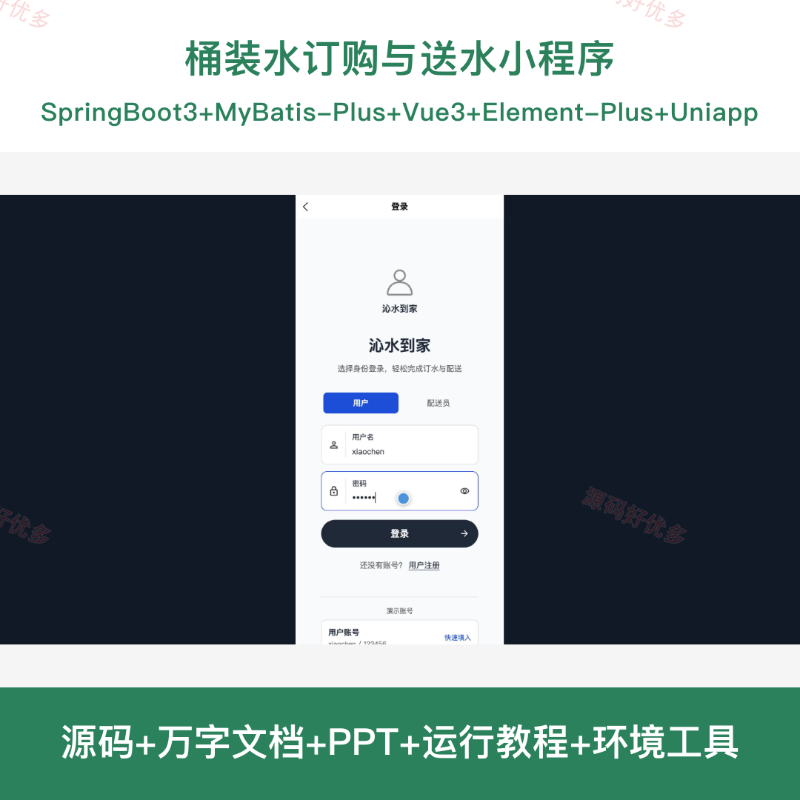
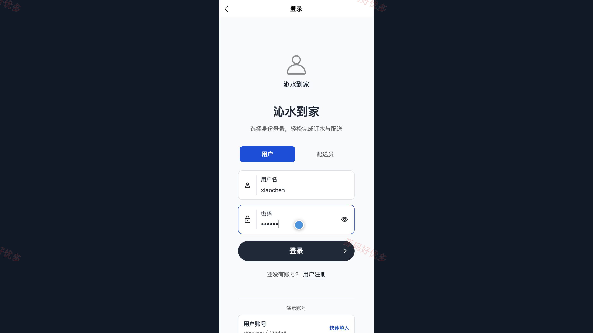
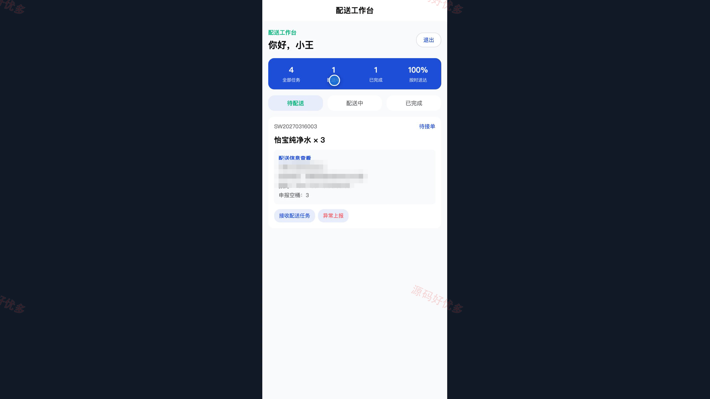
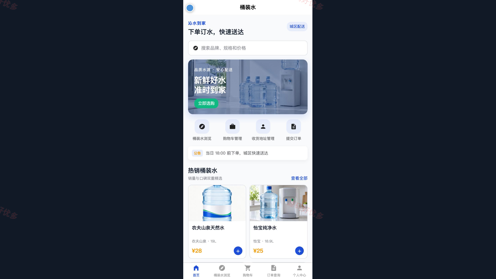
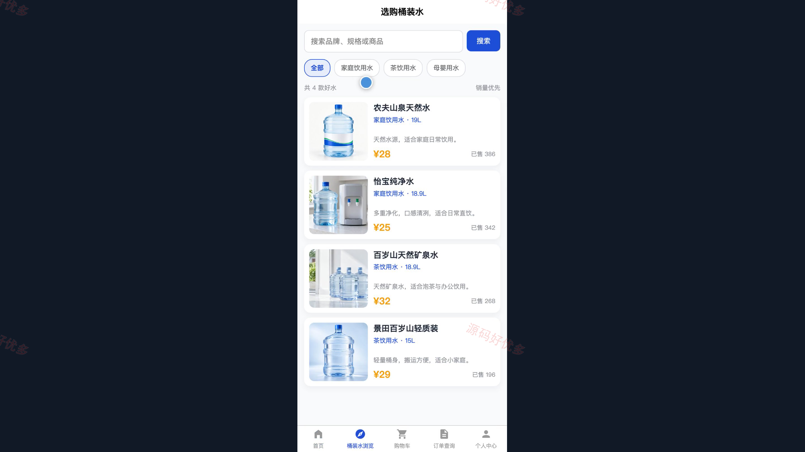
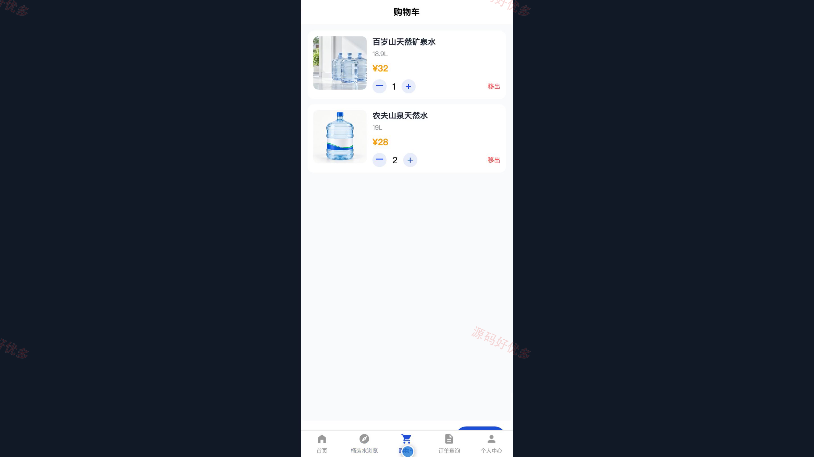
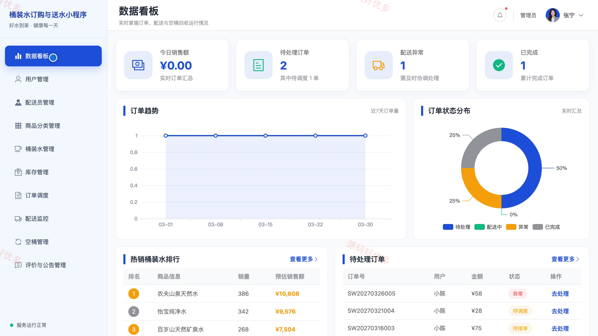
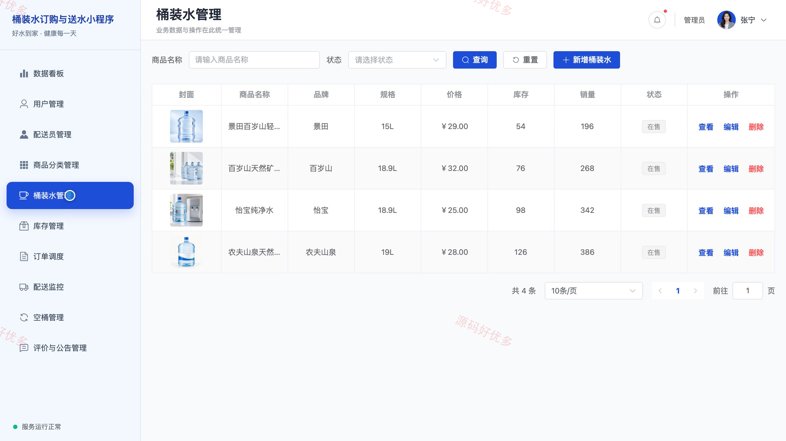
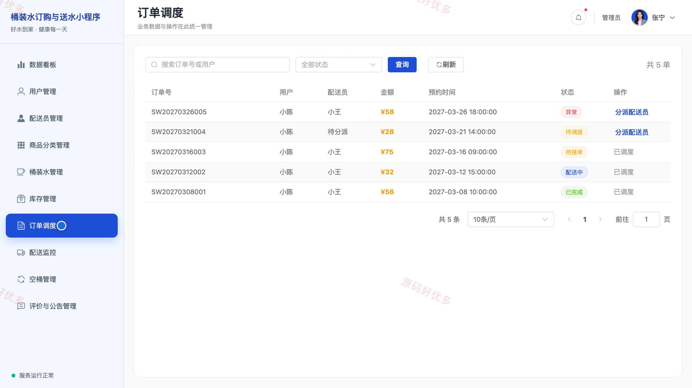

# bs127B
bs127B桶装水订购与送水小程序源码 Java SpringBoot3 Vue3 前后分离
## 源码问题查看主页咨询

### 一、关键词
桶装水订购、送水上门、配送调度、空桶回收、送水订单小程序

### 二、作品包含
源码+数据库+万字设计文档+PPT+全套环境和工具资源+本地部署教程

### 三、项目技术
前端技术： Html、Css、Js、Vue3.4、Element-Plus、uniapp
后端技术：Java、SpringBoot3.2.0、MyBatis-Plus

### 四、运行环境要求
开发工具：IDEA/eclipse + VSCODE + HBuilder X + 微信开发者工具

数据库：MySQL5.7+（共13张表）

数据库管理工具：Navicat10以上版本

环境配置软件： JDK17 + Maven3.6.3

前端Nodejs：20.19.5

浏览器：谷歌浏览器

### 五、项目介绍
项目编号：bs127B

桶装水订购与送水小程序包含用户订水端、配送员工作台、管理员 Web 后台及 Spring Boot 服务。用户可浏览桶装水、维护收货地址、下单并查询配送进度；配送员处理分配给自己的任务并登记空桶回收；管理员管理商品、库存和配送调度。

角色：用户、配送员、管理员

用户功能：桶装水浏览与商品详情、购物车管理、收货地址管理、预约下单与空桶申报、订单与配送进度查询、完成订单评价、服务公告查看。

配送员功能：配送任务与个人统计查看、接收配送任务、开始配送与确认送达、空桶回收登记、配送异常上报。

管理员功能：数据看板、用户与配送员管理、商品分类与桶装水管理、库存与空桶管理、订单调度与配送监控、评价与公告管理。

### 六、运行截图

